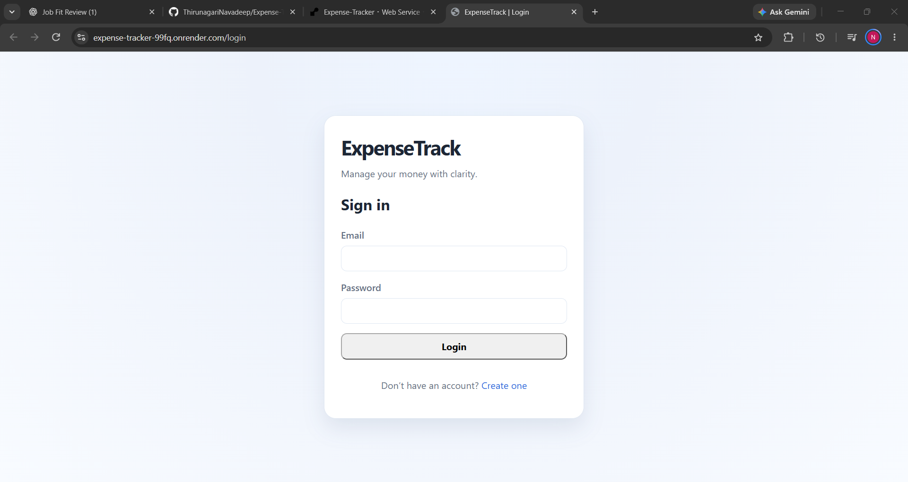

# ExpenseTrack

ExpenseTrack is a personal finance dashboard built with FastAPI, SQLAlchemy, SQLite and vanilla HTML/CSS/JavaScript. It helps users manage their income, expenses, budgets and financial summaries while keeping each user’s data isolated and secure.

## Features
- Secure registration and login with hashed passwords
- Session-based authentication with cookies
- Protected dashboard with monthly totals
- Income and expense tracking with filters and search
- Default and custom categories
- Budget creation and budget utilization tracking
- Reports for category-wise and monthly summaries
- Responsive UI for desktop and mobile screens
- Swagger/OpenAPI API documentation

## Screenshots




## Architecture

- Backend: FastAPI + SQLAlchemy + SQLite
- Frontend: HTML5, CSS3 and vanilla JavaScript
- Authentication: secure cookie sessions and Argon2 password hashing
- Data layer: SQLite with models for users, categories, transactions and budgets

## Project Structure

```text
ExpenseTrack/
├── app/
│   ├── __init__.py
│   ├── main.py
│   ├── config.py
│   ├── database.py
│   ├── auth.py
│   ├── models/
│   ├── routes/
│   ├── schemas/
│   ├── services/
│   ├── static/
│   └── templates/
├── tests/
├── screenshots/
├── .env.example
├── .gitignore
├── AGENTS.md
├── SPEC.md
├── requirements.txt
├── pytest.ini
├── README.md
└── scripts/
```

## Local Setup

1. Create a virtual environment:

```bash
python -m venv .venv
source .venv/bin/activate  # Linux/macOS
.venv\Scripts\activate  # Windows
```

2. Install dependencies:

```bash
pip install -r requirements.txt
```

3. Copy the environment file and update values if needed:

```bash
copy .env.example .env
```

4. Start the app:

```bash
uvicorn app.main:app --reload
```

5. Open the app in a browser:

- Login: http://127.0.0.1:8000/login
- Register: http://127.0.0.1:8000/register
- API docs: http://127.0.0.1:8000/docs

## API Documentation

FastAPI provides interactive Swagger docs at `/docs` and ReDoc at `/redoc`.

## Testing

Run the automated tests with:

```bash
pytest -q
```

## Notes

- SQLite is used for local development and is easy to replace with a different backend.
- All user-owned records are isolated by `user_id` and protected with authorization checks.
- Passwords are hashed before storage.
